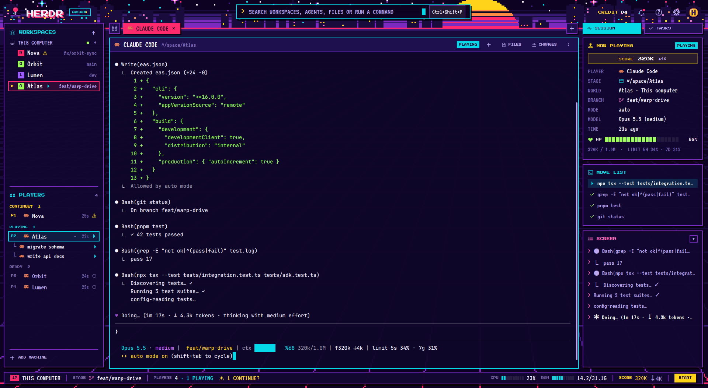

# Arcade: an 8-bit layout for Herdr

A night-time arcade for the [Herdr](https://herdr.dev) app: chunky neon pixel panels over a
pixel sunset, a city skyline and a neon grid. Agents are **players** (P1, P2…): **PLAYING** while
they work, **CONTINUE?** when they need you, **STAGE CLEAR** when they finish, **READY** when idle.
The session panel shows the run as **NOW PLAYING**, with a **SCORE** (tokens) and an **HP** bar
(context left), then the **MOVE LIST** (recent commands) and the **SCREEN** (latest output). The
score bar at the bottom has the stage (branch), the players, CPU and RAM meters and a **START**
button for the command palette.



All the art (background, logo, coin and the 32 icons) is original and generated by the scripts in
[`art/`](art).

## Install

Ask your agent in Herdr to add it:

> add the layout github.com/PsyChaos/herdr-arcade

Or copy it by hand:

```sh
git clone https://github.com/PsyChaos/herdr-arcade
cp -r herdr-arcade/mods/arcade herdr-arcade/mods/arcade-files herdr-arcade/mods/arcade-changes ~/.config/herdr-app/mods/
cp herdr-arcade/layouts/arcade.json ~/.config/herdr-app/layouts/
cp herdr-arcade/themes/arcade.json ~/.config/herdr-app/themes/
herdr-app do layout.switch '{"name":"arcade"}'
```

`ctrl-shift-l` switches back to your own layout.

## Tasks tab (optional)

The right column gets a **TASKS** tab when the [task-board](https://github.com/PsyChaos/herdr-mods/tree/main/task-board)
mod is installed: it lists the tasks your agents hand out to sub-agents (`hc run`), grouped under
the agent that started them. Without it Arcade shows only the session panel.

> add the mod github.com/PsyChaos/herdr-mods/tree/main/task-board

Arcade finds it within 30 seconds and adds the tab. It then writes `task-board` into
`layouts/arcade.json`; if you remove task-board later, put that layout back from this repo too,
or Herdr won't open it.

## What it reads

- **Agent screens:** it runs `hc read` (the visible screen only) on the agent it shows, to find the
  model, effort, context and token counts in Claude Code's status line, plus its recent shell
  commands and output.
- **System files:** it reads `/proc/stat` and `/proc/meminfo` for the CPU and RAM meters.
- **Layout:** when task-board is installed it runs `herdr-app do layout.set` to point the Tasks
  block at it (once; again only if the block is put back).
- **Network:** it makes no network requests.

To get the model, context and token details, use a Claude Code status line like
the one in [`extras/claude-statusline.sh`](extras/claude-statusline.sh):

```sh
cp extras/claude-statusline.sh ~/.claude/statusline.sh
jq '.statusLine={"type":"command","command":"~/.claude/statusline.sh","padding":0}' ~/.claude/settings.json > /tmp/s && mv /tmp/s ~/.claude/settings.json
```

## Files and Changes panels

`mods/arcade-files` and `mods/arcade-changes` are copies of Herdr's own `files` and `changes`
mods (Apache License 2.0, the license is in each folder) with square corners and larger text, so
they match the layout. [`tools/fork-panels.py`](tools/fork-panels.py) regenerates them from your
Herdr install: `python3 tools/fork-panels.py arcade 2 2`.

## Fonts

`mods/arcade/fonts/` ships [Press Start 2P](https://fonts.google.com/specimen/Press+Start+2P)
(headings) and [VT323](https://fonts.google.com/specimen/VT323) (text), both under the SIL Open
Font License; the license texts are next to them. They are used for Arcade's own panels only, so
other mods keep Herdr's font and size.
