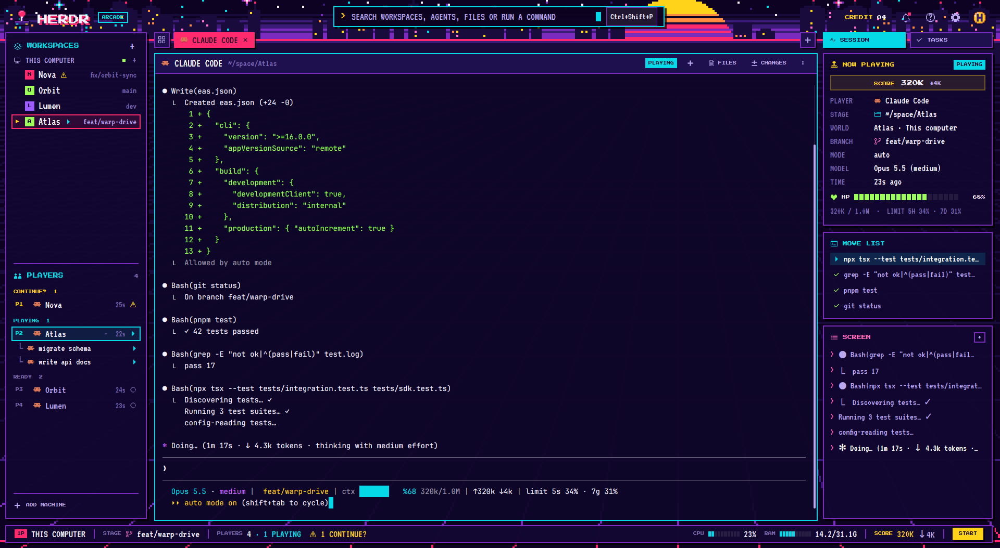

# Arcade

An 8-bit night-time arcade layout for Herdr. The window sits on a pixel-art scene: a starry
purple sky, a striped yellow-to-magenta sun sinking behind a city skyline, a magenta horizon and
a neon perspective grid floor. Every region is a chunky square panel with a 2px violet border and
a hard black pixel shadow down-right; labels are in the Press Start 2P pixel font and text in the
VT323 terminal font. Agents are **players** (P1, P2…): **PLAYING** while they work,
**CONTINUE?** when they need you, **STAGE CLEAR** when they finish, **READY** when idle. Top to
bottom: a title bar with the HERDR wordmark, a centred command search, CREDIT and a bell; then
three columns: workspaces and players on the left, the active tab's panes in the middle (each in
its own frame with a header), and the **SESSION** panel on the right (NOW PLAYING with a SCORE
and an HP bar, MOVE LIST, SCREEN; plus a **TASKS** tab when the task-board mod is installed);
then a score bar with machine, stage, players, CPU, RAM, SCORE and a yellow START button. All
artwork (background, icons, logo, coin) is original: no existing game's characters or sprites.



## What you see

**Everywhere.** Panel fill `#120733e8`, 2px `#7b2cbf` border, square corners, and a hard shadow
`#000000b8` offset 4px right and 4px down (3px under buttons). Text `#f6f1ff`, muted `#bba9f0`,
dim `#7d6bb3`; accents cyan `#05d9e8`, magenta `#ff2a6d`, hot pink `#ff6ec7`, yellow `#ffd319`,
lime `#9cff57`, orange `#ff8c42`, violet `#9d5cff`; night `#0d0221`, raised `#1e0f4e`.
Headings, labels, chips and numbers use **Press Start 2P** (7 to 11px, the wordmark 20px; line
height 1.5× the size unless stated); names and values use **VT323** (16 to 21px). Both fonts sit
in `mods/arcade/fonts/` and are set only on Arcade's own panels: other mods (menus, palette,
Files, Changes) keep Herdr's UI font. Hover on rows is a white wash `#ffffff10` (buttons
`#ffffff14`). A pixel button: 30px tall (START 24px), 2px border, fill `#1e0f4e`, `#7b2cbf`
border, muted text; hover turns its border cyan; lit (on) it is filled and bordered in its tone
(magenta for tabs, cyan for SESSION/TASKS, yellow for START) with night `#0d0221` text.

**Background.** `mods/arcade/arcade-bg.png`, 1920×1080, `cover`, behind everything: a 480×270
pixel picture scaled 4× nearest-neighbour, 16 colours. Rows 0 to 21 (of 270) are sky: night
`#0d0221` on top with 70 stars (white, cyan, pink, faint purple) and seven 4-point twinkles,
then stepped bands of `#1a0b3d`, `#3b1a78`, `#7b2cbf` toward the horizon; the sun (centre
x 325, radius 28, top at row 2) in yellow, orange and magenta bands with dark gaps cut through
its lower half; a `#1a0b3d` skyline in five clusters with three landmark towers, magenta antenna
lights and scattered lit windows. Row 22 is a magenta horizon line. Rows 23 to 49 are haze. From
row 50 a perspective grid floor whose vanishing point is under the sun: lines barely visible
(`#1a0b3d` on `#0d0221`) down to row 219 so panel text stays readable, then `#3b1a78`, `#7b2cbf`
and finally magenta in the bottom band behind the score bar. The canvas is transparent and
terminals are drawn at opacity 0, so the picture shows through every gap.

**Window.** Outer padding 6px top and bottom, 10px left and right. No system title bar.

1. **Title bar, 56px** (drags the window), 14px side padding, items 16px apart:
   - Left: the joystick logo (`logo.svg`, 36px), then the wordmark "HERDR" in Press Start 2P
     20px white over a magenta copy 3px down-right, then an "ARCADE" badge (7px cyan text, 2px
     cyan border, 6×3px padding).
   - Centre: the search field, a 640px-wide box (636px plus its 4px shadow) centred in the
     window by equal flexible sides: cyan border, fill `#0d0221f0`, 36px inside. A yellow ">"
     (11px), the placeholder "SEARCH WORKSPACES, AGENTS, FILES OR RUN A COMMAND" (VT323 20px
     muted, truncates), a 10×18px cyan block cursor, and at the right the palette key read from
     the person's keys (e.g. `Ctrl+Shift+P`, `⌃⇧P` style on macOS) in a chip (VT323 17px on
     `#ffffff14`, 1px `#7b2cbf` border). No chip when the palette has no key.
   - Right, 14px apart: "CREDIT" (9px yellow) and the number of agents as two digits ("04",
     9px white); then 34px square buttons: the bell (20px), help (19px), settings (19px); a 30px
     gold coin (`coin.svg`) with a purple "H"; on Linux and Windows then a 6px gap and the
     window buttons "_", "#" ("=" when maximized) and ×. Settings appears only here.
   - The bell carries a 6px square at its top right when an agent needs you (magenta) or, failing
     that, when one finished (lime). No square otherwise.
   - On macOS (not fullscreen) the bar starts 84px in, leaving room for the traffic lights at
     (18, 22).

2. **Body row**, three columns 10px apart.

   - **Sidebar, 276px** (drag 230 to 480). One framed panel, 10px padding top and bottom:
     - Header (30px, 14px side padding): cyan layers icon (16px), "WORKSPACES" (10px cyan), a
       24px "+" (VT323 24px muted).
     - Per machine: a 24px row with a monitor (this computer) or server icon (14px muted), the
       name in capitals ("THIS COMPUTER", VT323 18px muted), a 6px square (lime ready, yellow
       loading, dim otherwise) and a "+" (VT323 20px dim). Under it that machine's spaces. A
       remote machine with no spaces is left out; this computer always shows.
     - A space row, 28px (10px in from the panel, 6px padding): a 10px slot holding the **menu
       cursor**, a yellow "▶" (8px), on the active space only; an 18px letter tile (the first
       letter or digit in Press Start 2P 8px night, on one of seven colours picked by a hash of
       the name: magenta, cyan, yellow, lime, orange, pink, violet); the name (VT323 21px, at
       most 140px, white when active); a 12px status mark unless idle; right-aligned
       "repo · branch" (VT323 17px, muted when active, else dim; the folder name is left out
       when it matches the space name or is the home folder). The active space has a 2px magenta
       border over `#ff2a6d1f`.
     - A 2px `#7b2cbf` rule (14px in, 8px above and below), then header "PLAYERS" (agents icon)
       with the number of top-level players (8px dim).
     - Players in groups, each under a label (7px, 10px above, 3px below) with its count:
       **PINNED** (pink), **CONTINUE?** (yellow), **PLAYING** (cyan), **STAGE CLEAR** (lime),
       **READY** (dim); empty groups hidden; "INSERT COIN" (8px dim) when there are none.
     - A player row, 28px: "P1", "P2"… (7px, in the status colour, 26px slot), the program
       icon (15px; terminal icon if none), "space · tab" (VT323 20px; a numeric tab name is left
       out; muted when idle and not focused), a fold mark when it has sub-agents ("−" open,
       "+N" folded; VT323 17px dim), the time since its last change ("25s", "4m", "3h", "2d";
       VT323 16px dim, 26px right-aligned) and a 13px status mark. The focused player has a 2px
       cyan border over `#05d9e81a`.
     - Sub-agents under their parent, 24px rows: "└" right-aligned in 16px per level (VT323
       18px dim), program icon (14px), its `task` label (else name, template, program or
       address; VT323 18px, muted when idle) and a 12px status mark. Sub-agents of sub-agents
       nest further.
     - Another rule, then the footer "+ ADD MACHINE" (plus icon 14px, 7px muted), 28px.
     - The spaces list and the players list share the height equally and scroll on their own.

   - **Work column** (takes the rest):
     - **Tab bar, 40px** (drags the window): items 8px apart along its top. A 30px square grid
       button, the tabs (a 34px-tall strip that scrolls sideways) and a 30px square "+". Each
       tab is a pixel button with 10px side padding: the program icon (15px) for an agent or a
       terminal icon for a shell, the name in capitals (VT323 20px, at most 170px; an auto-named
       tab, a number or `tbN`, shows the agent's program name, else its index; " ⤢" when
       zoomed). The active tab is lit magenta with night text and a 12px × at its end. An
       inactive tab whose status isn't idle shows a 6px square in the status colour.
     - **Panes and side panel**, 12px apart:
       - Each pane of the active tab is its own square box, even when alone: fill
         `#0e0628f0`, 2px `#7b2cbf` border, cyan `#05d9e8` while it has the keyboard; 12px
         between panes; terminal padding 14px × 12px.
       - Each pane has a 38px header band on top: fill `#1e0f4e`, a 2px `#7b2cbf` line under
         it, 12px side padding, items 10px apart. Program icon (15px), the name in capitals
         (VT323 21px white, at most 260px), the folder with `~` for home (VT323 18px dim,
         truncates), the status chip unless idle, then 24px buttons: "+", "FILES" (file icon),
         "CHANGES" (changes icon) (13px icons, 7px labels) and ":" (9px). The buttons have a
         transparent 2px border that turns cyan on hover; FILES or CHANGES is filled cyan with
         night text while its view is showing.
       - The **side panel**, hidden at start, 368px (drag 280 to 900), to the right of the
         panes, holding Arcade's own copy of Files or Changes: square corners, a 2px `#7b2cbf`
         frame over `#0d0221`, Herdr's UI font 2px larger than the shipped panels (rows 29px).

   - **Right column, 330px** (drag 260 to 520):
     - **Switch**, a 40px block: "SESSION" (activity icon) and, only when task-board is
       installed, "TASKS" (check icon), equal-width pixel buttons 8px apart (13px icons, 8px
       labels). The active one is lit cyan.
     - **Session**: three framed cards 8px apart. Each card: 12px side padding, 10px top, 12px
       bottom; a 22px header with a 15px icon and a 9px title in the card's colour.
       - **NOW PLAYING** (yellow joystick icon). At the top right the status chip. With no
         agent: "FOCUS A PLAYER'S PANE" (7px dim). Then, when the screen shows token counts, the
         **SCORE** line: a 30px box (fill `#ffd3191a`, 2px `#ffd31955` border), centred
         "SCORE" (8px yellow), the tokens in ("320K", 11px white) and "↓4K" (7px muted). Then
         20px rows (76px dim label in VT323 18px, value in VT323 19px, "—" when unknown):
         PLAYER (program icon, program name), STAGE (cyan folder icon, the pane's folder, else the space name),
         WORLD ("space · machine" or "space · This computer"), BRANCH (only when the pane has
         one; pink branch icon), MODE (auto, accept edits, plan, bypass or default), MODEL
         ("Opus 5.5 (medium)"), TIME ("23s ago", "4m 12s ago": since it started working, else
         since its last change). When the screen shows a context figure: the **HP** row, a
         14px heart (lime above 50%, yellow above 20%, else magenta), "HP" (8px), a 12px bar
         of 20 blocks 2px apart in the same colour over `#ffffff14`, filled to the percent of
         context left, and that percent (8px, 44px right-aligned); under it "320K / 1.0M  ·
         LIMIT 5H 34% · 7D 31%" (VT323 17px dim).
       - **MOVE LIST** (cyan terminal icon): the last six `Bash(...)` commands on the agent's
         screen, newest first, 24px rows in VT323 18px, a lime check before each; the newest
         white, the rest muted. While working, the newest has a `#05d9e826` fill and a cyan play
         arrow instead of the check. Empty: "NO MOVES ON SCREEN YET".
       - **SCREEN** (pink list icon) takes the rest of the column: the last seven lines above
         the agent's input box in VT323 18px, each after a pink ">", truncated; the last line
         white, the others muted. Empty: "> WAITING FOR OUTPUT_". A small "+" button (8px,
         2px `#7b2cbf` border, cyan on hover) at the top right.
     - **Tasks**: the task-board mod in a framed box (fill `#120733e8`, 2px `#7b2cbf` border).

3. **Score bar, 46px**: a framed strip (fill `#120733f0`) 8px below the columns, 34px tall,
   16px side padding, items 16px apart, labels 7px dim, values VT323 20px, 2×18px `#7b2cbf`
   separators. Left: a magenta "1P" chip (7px night) and the machine ("THIS COMPUTER"); "STAGE"
   with a pink branch icon and the active space's branch, when it has one; "PLAYERS 4" and
   "· 1 PLAYING" in cyan when any work; "⚠ 1 CONTINUE?" in yellow when any need you. Right:
   "CPU", a 60×10px meter of 10 blocks and "23%"; "RAM", a meter and "14.2/31.1G"; "SCORE"
   (yellow label) "320K" (yellow) "↓4K" (muted) when known; a separator; and the yellow
   **START** button (24px, 7px night text). A meter's blocks are cyan, yellow above 60%,
   magenta above 85%, over `#ffffff18`.

**MESSAGES popup.** 380px wide, fill `#120733fa`, 2px cyan border. A 44px header: a 15px cyan
bell, "MESSAGES" (9px cyan) and "N NEW" (7px yellow), a 2px `#7b2cbf` line under it. Then the
sections **CONTINUE?** (yellow) and **STAGE CLEAR** (lime), 28px labels (7px), of 46px rows: a
transparent 2px border that turns cyan on hover, program icon (16px), "space · tab" (VT323 20px)
and under it the arcade word plus " · machine" for a remote agent (VT323 16px, status colour),
the time since the change (VT323 16px dim) and a 14px status mark. Newest first in each section.
With nothing to show: "NO MESSAGES" (8px dim) centred in 70px. The popup is as tall as its
rows, at most 480px, and scrolls beyond that.

**Status marks** (16px pixel icons tinted): working, a cyan play arrow; blocked, a yellow
warning sign; done, a lime star; idle, a dim ring. **Status chip**: the arcade word in 7px
Press Start 2P, 6×4px padding, night text on the status colour; idle "READY" muted on
`#ffffff14`; no agent "NO PLAYER".

**Theme** (`themes/arcade.json`): terminal background `#0e0628`, text `#f6f1ff`, selection
`#5a1a52`, cursor `#05d9e8`, accent `#ff2a6d` (accent foreground `#0d0221`); status colours
working `#05d9e8`, blocked `#ffd319`, done `#9cff57`, idle `#7d6bb3`; ANSI `#1a0b3d #ff2a6d
#9cff57 #ffd319 #3d7bff #d16bff #05d9e8 #d9ccff` and bright `#5b4a8f #ff6e9c #c2ff8f #ffe680
#7aa5ff #ff9cf0 #7ff3fb #ffffff`.

## How it behaves

**Agent status, everywhere it shows** (one set of colours and words):

- **working → PLAYING, cyan:** a cyan play arrow on its row, its space row and sub-agent rows;
  listed under PLAYING with a cyan "P" number; a cyan square on its tab when that tab isn't
  active; a "PLAYING" chip in its pane header and in NOW PLAYING; the newest MOVE LIST command
  highlighted with a play arrow; the score bar counts it ("· 1 PLAYING").
- **blocked → CONTINUE?, yellow:** a yellow warning mark; listed under CONTINUE?; a yellow tab
  square; a "CONTINUE?" chip in the pane header and NOW PLAYING; the magenta bell square; first
  in the MESSAGES popup; "⚠ 1 CONTINUE?" in the score bar.
- **done → STAGE CLEAR, lime:** a lime star; listed under STAGE CLEAR; a lime tab square; a
  "STAGE CLEAR" chip; the lime bell square when nobody is blocked; listed under STAGE CLEAR in
  the popup. Herdr turns it idle once you look at it, and it leaves the popup.
- **idle → READY, dim:** a dim ring; listed under READY with muted text; no tab square and no
  pane-header chip; the muted "READY" chip in NOW PLAYING; space rows hide the mark.
- Pinned agents stay under PINNED whatever their status. A sub-agent never shows done (it shows
  idle: the parent's done is the news) and an errored one shows blocked.

**Numbers.** P1, P2… follow the order on screen (PINNED first, then CONTINUE?, PLAYING, STAGE
CLEAR, READY); sub-agents get none. **CREDIT** is the number of agents (every agent, two digits).
The PLAYERS header counts top-level players; the score bar's PLAYERS counts every agent.
**SCORE** is the tokens in (and "↓" out) from the agent's status line; **HP** is the percent
of context left.

**Which agent the Session panel shows:** the focused agent; else the newest agent in the focused
tab; else the newest in the focused space; else none ("NO PLAYER"). The score bar's SCORE is
for the same agent.

**Clicks, keys and hovers:**

- Title bar: the search field (and the score bar's START) opens the command palette; the bell
  opens the MESSAGES popup, and a row there closes it and focuses that agent's pane; help opens
  help; settings opens settings; _ # × minimize, maximize and close. The logo, wordmark, badge,
  CREDIT and coin do nothing.
- Sidebar: WORKSPACES "+" makes a space; a machine's "+" makes a space on that machine; a space
  row selects it (the ▶ cursor moves there); a player row focuses its pane; its program icon or
  fold mark folds or unfolds its sub-agents; a sub-agent row focuses it when it has a pane, else
  peeks it (a pane-less one started with `hc run --bg`); "ADD MACHINE" opens the machine-add
  dialog.
- Tab bar: click selects; double-click renames; right-click opens the tab menu; × closes the
  active tab; the mouse wheel over the bar steps to the previous or next tab; the grid opens the
  picker; "+" opens the new-tab menu (250 × 512).
- Pane header: a click focuses the pane; "+" splits it to the right; FILES or CHANGES shows the
  side panel on that view, and clicking the lit one again hides it; ":" opens the pane menu.
- Right column: SESSION and TASKS switch the view. SCREEN's "+" grows it over the whole column
  (NOW PLAYING and MOVE LIST go away) with the last ~60 lines, scrollable; "-" shrinks it back.
- Drag the gaps between the sidebar, work column and right column, and between the panes and
  the side panel, to resize within the limits above. The tab bar and the switch don't resize.
- Hover: sidebar rows get a faint white wash, the title bar's square buttons `#ffffff14`;
  pixel buttons, pane-header buttons and MESSAGES rows get a cyan border.
- It adds no keys of its own.

**What moves:** nothing animates. The Session panel re-reads the agent's screen every 4 s (not
while TASKS is shown); the score bar re-reads the screen, CPU and RAM every 5 s (CPU appears from
the second reading); the sidebar's "25s" labels refresh every 30 s. The TASKS tab appears within
30 s of installing task-board.

## Built from

**Files:** `layouts/arcade.json`, `themes/arcade.json`, and three mod folders:
- `mods/arcade/`: `mod.json` `{ "place": "none", "title": "Arcade" }`, `main.js`, `ui.js`,
  `arcade-bg.png`, the SVG icons, `fonts/` (`PressStart2P-Regular.ttf`, `VT323-Regular.ttf`,
  `OFL-PressStart2P.txt`, `OFL-VT323.txt`), `preview.png` (the layout's settings picture).
- `mods/arcade-files/` and `mods/arcade-changes/`: copies of Herdr's shipped `files` and
  `changes` mods (`main.js`, `mod.json` `{ "place": "none" }`, their SVG icons and `LICENSE`).

Layout root: `"titlebar": "none"`, `"traffic_lights": [18, 22]`,
`"preview": "mods/arcade/preview.png"`, `"theme": "arcade"`, `"padding": [6, 10]`, `"gap": 0`,
`"terminal_padding": [14, 12]`, `"terminal_opacity": 0`,
`"background": { "image": "mods/arcade/arcade-bg.png", "fit": "cover" }`, no `font` or
`ui_font`, and `colors`: canvas `#00000000`, chrome `#120733f0`, surface `#120733e8`,
background `#0d0221`, border `#7b2cbf`, input `#05d9e8`, hover `#ffffff14`, selected
`#ff2a6d55`, raised `#1e0f4ef0`, popover `#120733fa`, muted `#bba9f0`, dim `#7d6bb3`.

**Node tree** (`arcade` = this mod with that `props.role`):

```
root column
├─ top        block 56px, window_drag        arcade "top"
├─ body       row, gap 10, resizable
│  ├─ sidebar block 276px (min 230, max 480) arcade "sidebar"
│  ├─ work    column, weight 1, resizable false
│  │  ├─ tabs       block 40px, window_drag  arcade "tabs"
│  │  └─ work-body  row, padding 0, gap 12, resizable
│  │     ├─ main    block { "tab": "active", "pane": {...} }
│  │     └─ panel   column, hidden, 368px (280..900), no background or border
│  │        └─ panel-body  stack, active "files"
│  │           ├─ files    block, mod "arcade-files"
│  │           └─ changes  block, mod "arcade-changes"
│  └─ session column 330px (260..520), resizable false
│     ├─ side-tabs  block 40px               arcade "sidetabs"
│     └─ side-body  stack, active "side-session", "padding": null
│        ├─ side-session block               arcade "session"
│        └─ side-tasks   block, background #120733e8, border 2 #7b2cbf
│                                            arcade "tasks" (switched to mod "task-board")
└─ status     block 46px                     arcade "status"
```

`main`'s pane frame: `{ "gap": 12, "radius": 0, "background": "#0e0628f0", "lone": true,
"border": { "width": 2, "color": "#7b2cbf" }, "focus": { "width": 2, "color": "#05d9e8" },
"header": { "content": { "mod": "arcade", "props": { "role": "pane" } }, "height": 38,
"position": "top", "reveal": "always" } }`.

**Roles** (one `View` in `main.js`; `this.role = props().role ?? "session"`): `top`, `sidebar`,
`tabs`, `pane` (one copy per pane, reads `props().pane`), `sidetabs`, `session`, `tasks` (an
empty `div`, a stand-in), `status`, and `bell` (opened by
`openOverlay({ mod: "arcade", kind: "popup", width: 380, height, props: { role: "bell", height } })`
with `height = bellHeight(...)`, closed with `closeOverlay(props().overlay)`). `render()` returns
`this.draw(cx).font_family("VT323")`, so each role's root carries the pixel font.

**`ui.js`** holds the look: `F` (`head: "Press Start 2P"`, `body: "VT323"`), the colours `C`,
`STATUS` (status → colour) and `WORD` (working PLAYING, blocked CONTINUE?, done STAGE CLEAR,
idle READY), `pt(text, size = 10, color, lineHeight = round(size × 1.5))` (Press Start 2P text)
and `vt` (VT323 text), `frame(key, el, { edge, fill, shadow, tall, depth = 4 })` (a relative box
holding an absolute shadow `div` at `top(depth).left(depth)` and the bordered box over it),
`button(id, child, action, { on, tone, h = 30, w })` (the same with a 3px shadow; it stops the
left mouse-down), `hpBar(pct, { blocks = 20, h = 12 })`, `meter(pct, { blocks = 10, w = 60, h = 10 })`,
`icon`, `programIcon` (tinted `svg` or `image` from `program.icon`), `letterTile`,
`statusMark`, `chip`, `ago`.

**Session data.** `hc(["read", agent.address, "--lines", "0"])` (the visible screen only),
parsed from the bottom up:
- the Claude Code status line
  `model · effort | … ctx <bar> %<left> <used>/<size> … ↑<in> ↓<out> … 5s <n>% … 7g <n>%`
  (what `extras/claude-statusline.sh` prints; effort one of low, medium, high, xhigh, max);
- `(auto mode|accept edits|plan mode|bypass permissions) on` for MODE;
- `✻ <Verb>… (<detail>)` (any of `✻✽✢·*✶✳`) is parsed but not shown;
- lines `● Bash(...)` or `⏺ Bash(...)` for MOVE LIST (last six, newest first);
- output: the lines above the second-to-last rule of 20+ `─` (the input box's top edge),
  trailing spaces trimmed, without blank lines, rules and "Update available!"; the last 7, or
  the last 60 when grown.
Values are upper-cased for display (`320k` → `320K`). A `busy` flag keeps a copy's reads from
overlapping; the session copy skips its read while `side-body` shows `side-tasks`. The status
copy reads the same way, plus `/proc/stat` (CPU from the change between two readings) and
`/proc/meminfo` (MemTotal − MemAvailable, in GiB); off Linux the meters stay hidden.

**Sub-agents.** From `terminals()`: live ones with a `parent`, nested under the agent with that
address (a remote child's bare parent address gets the child's machine prefix). Ones started
with `hc run --bg` have no pane and are only in `terminals()`; kept ones are in `agents()` too
and show only under their parent unless pinned. Status from `agents()` when there, else the
terminal's. The fold state lives in a `Set` on the sidebar copy.

**Tasks tab.** The `sidetabs` copy runs `syncBoard` in `cx.spawn` at start and every 3 s; on the
first run and every tenth (every 30 s) it checks for `${appHome()}/mods/task-board/mod.json`
with `readTextFile`. When task-board exists and `side-tasks` doesn't name it, it runs
`exec("herdr-app", ["do", "layout.set", JSON.stringify({ layout })])` with a copy of `layout()`
whose `side-tasks.content` is `{ "mod": "task-board" }`. When it's missing and `side-tasks` is
showing, it selects `side-session`. The TASKS button is drawn only while `side-tasks` names
task-board. task-board lives at github.com/PsyChaos/herdr-mods and is not shipped with Herdr.

**The Files and Changes copies.** `mods/arcade-files` and `mods/arcade-changes` exist because
the shipped panels have rounded corners and small text that look wrong in square pixel frames.
`tools/fork-panels.py <prefix> <text +px> <border px> [herdr-app home]` copies
`~/.config/herdr-app/mods/{files,changes}` (`main.js`, `mod.json`, `*.svg`) and rewrites
`main.js`: paths `mods/<name>/` → `mods/<prefix>-<name>/`; every `.rounded(n)` removed; every
`.text_size(n)` + the text growth (terminal-font text, and the preview's `font_size`, by at most
2px); `.h(28)` rows grow by up to 6px (growth − 1); `.border_1().border_color(t.border)` →
`.border(<border px>)`. It adds a two-line header naming the change and copies Herdr's
Apache-2.0 `LICENSE` from `~/.local/share/herdr-app/LICENSE` into each copy (Herdr is Apache
2.0, so each copy carries the license). These copies were made with
`python3 tools/fork-panels.py arcade 2 2`: text 2px larger (files 13 to 15px, editor preview
14px), rows 29px, 2px borders, square. Run it again after a Herdr update. They take their
colours from the theme (`background`, `border`, `hover`, `selected`, `raised`, …), which the
layout's `colors` set.

**Herdr functions:** `agents`, `terminals`, `spaces`, `panes`, `focused`, `machines`, `layout`,
`props`, `keys`, `window`, `home`, `appHome`, `hc`, `exec`, `readTextFile`, `run`,
`openOverlay`, `closeOverlay`; from `gpui-kit` `View`, `div`, `svg`, `image`; from `gpui-base`
`h_flex`, `v_flex`.

**Commands run:** `app.palette`, `app.help`, `app.settings`, `window.minimize`,
`window.maximize`, `window.close`, `space.new` (also `{ machine }`, `""` for this computer),
`space.select { id }`, `pane.focus { pane }` or `{ terminal }`, `terminal.peek { terminal }`,
`mod.open { name: "picker" | "machine-add" }`, `tab.select`, `tab.rename`, `tab.close { id }`,
`tab.prev`, `tab.next`, `pane.split { direction: "right", pane }`,
`layout.show` / `layout.hide { id: "panel" }`, `layout.select { stack, child }` (`panel-body`
to `files`/`changes`; `side-body` to `side-session`/`side-tasks`).

**Shipped mods used:** `menu` (tab menu popup 200px wide with
`{ tab: "tab", target: { id, space } }`; pane menu popup 220px wide with
`{ tab: "pane", target: { pane, terminal } }`); `new-menu` (popup 250 × 512); `picker` and
`machine-add` (`mod.open`); `files` and `changes` only as the source of the copies.

**Programs run:** `hc read` (through `hc()`), and `herdr-app do layout.set` (through `exec`, only
when task-board is installed and not yet in the layout). No network.

**Art** (all original; no existing game's characters or sprites):
- `arcade-bg.png` from `python3 art/background.py` (seed 1982): it writes `art/arcade-bg.svg`
  (480×270, one `crispEdges` path per colour) and runs
  `rsvg-convert -w 480 -h 270 art/arcade-bg.svg -o <tmp>/bg-480.png` and
  `magick <tmp>/bg-480.png -filter point -resize 400% -colors 16 -strip -define png:exclude-chunks=date,time PNG8:mods/arcade/arcade-bg.png`.
  Palette night `#0d0221`, deep `#1a0b3d`, purple `#3b1a78`, violet `#7b2cbf`, magenta
  `#ff2a6d`, pink `#ff6ec7`, orange `#ff8c42`, yellow `#ffd319`, cyan `#05d9e8`, lime
  `#9cff57`, white `#f6f1ff`. Composition as under Background.
- Icons from `python3 art/icons.py`: 16×16 pixel maps written straight into `mods/arcade/`
  (Herdr loads images only directly in `mods/<name>/`). Monochrome ones are `#ffffff` paths that
  the app tints: activity, agents, bell, changes, check, clock, close, coin-mono, cpu, file,
  folder, git-branch, grid, heart, heart-empty, help, joystick, layers, list, monitor, pause,
  play, plus, ram, ring, search, server, settings, star, terminal, trophy, warning. Two colour
  emblems: `logo.svg` (a joystick: magenta ball, white stick, violet base with a cyan and a
  yellow button) and `coin.svg` (a gold coin stamped with a purple "H").
- Fonts: Press Start 2P (© 2012 The Press Start 2P Project Authors) and VT323 (© 2011 The VT323
  Project Authors), both SIL Open Font License 1.1, licence texts beside them. Herdr loads
  `.ttf` files in a mod's `fonts/` folder at start.
- `art/demo-agent.sh [working|done]`: a fake Claude Code screen that reports its status by
  OSC 7501, for taking the preview.
- `extras/claude-statusline.sh`: the Claude Code status line the parser expects (needs `jq`).

## Watch out

- **Set the pixel font on each role's root, not as the layout's `ui_font`.** VT323 is small
  for its size; as `ui_font` it makes every other mod's text (menus, palette, Files, Changes,
  Ports, Docker…) far too small. `render()` adds `.font_family("VT323")` to each role's root
  instead, and the layout sets no font.
- **Press Start 2P sits high in its line box.** For the SCORE line to look vertically centred,
  its texts use a line height equal to their size (`pt(t, n, color, n)`) and the row has
  `pt(4)`.
- **Hard pixel shadows are an offset sibling and need room.** The shadow is an absolute `div`
  `depth` px down-right of the box, drawn outside it: every frame's wrapper has `pr(4).pb(4)`,
  the tab strip is 34px for 30px buttons, the search box is 640px including its shadow.
- **Images are cached by path.** A layout shown before its picture exists (the background, the
  preview) stays blank until Herdr restarts. Put the PNGs in place before the first
  `layout.switch`.
- **Read only the visible screen.** `hc read` with history takes seconds on a long Claude
  session and blocks the core: every terminal lags and loses its scroll position. Use
  `--lines 0`, never let reads overlap, and skip them while TASKS is shown. The session and
  status copies each read on their own timer (4 s, 5 s) with their own guard.
- **Herdr ignores writes to `this` during render.** All state changes happen in timers, spawned
  tasks and click handlers, followed by `cx.notify()`; `layout.set` is called from `cx.spawn`.
- **A mod can't import another mod's code** (imports outside its folder are refused), so the
  task board can't be embedded and the shipped Files and Changes can't be restyled from Arcade:
  the block has to name task-board, and the panels are copied.
- **Herdr refuses a layout that names a missing mod, whole.** So the shipped `side-tasks` block
  names this mod (role `tasks`) and is switched to task-board only once
  `mods/task-board/mod.json` exists; after the switch `layouts/arcade.json` names task-board,
  and removing task-board later breaks the layout until the shipped file is put back. For the
  same reason `arcade-files` and `arcade-changes` must be installed with `arcade`.
- **Inside a popup, `flex_1` children collapse to zero height.** The MESSAGES list gets an
  explicit height from `bellHeight` (44 header + 28 per section + 46 per row + 8, or 70 when
  empty; + 4 for the border; at most 480), and the popup is opened at that height and given it
  in `props.height`. It is measured when the bell is clicked; rows that arrive while it's open
  don't grow it.
- **Claude Code's own grey panels can't be recoloured.** It paints some of its own backgrounds
  with 256-colour index 235, `#262626`, which is outside the 16 ANSI colours a theme sets;
  they stay grey over the purple.
- **Sub-agents started with `hc run --bg` are not in `agents()`**: take them from
  `terminals()` (`parent`, `state === "live"`), peek them with `terminal.peek`, and guard the
  nesting against loops.
- **Buttons in the `window_drag` blocks** (title bar, tab bar) stop the left mouse-down
  (`cx.stop_propagation()`), or pressing them drags the window.
- **Run details depend on the status line.** Without a status line in the format of
  `extras/claude-statusline.sh` (`%68` with the sign first, limits labelled `5s`/`7g`, shown as
  5H/7D), MODE and MODEL show "—" and SCORE and HP are hidden, in the card and in the score bar.
  Only Claude Code's screen layout is parsed.
- **The Files and Changes copies drift from Herdr.** They are snapshots: rerun
  `tools/fork-panels.py arcade 2 2` after a Herdr update, keeping each copy's `LICENSE`.
- Limits: 6 commands, 7 output lines (60 grown), MESSAGES popup 480px tall, space name 140px,
  tab name 170px, pane name 260px, HP 20 blocks, meters 10 blocks. The logo, wordmark, ARCADE
  badge, CREDIT and coin are decoration. The icons clock, cpu, ram, search, heart-empty, trophy,
  coin-mono and pause are drawn but not used.

## Done when

- `herdr-app check` passes for `mods/arcade`, `mods/arcade-files` and `mods/arcade-changes`,
  `herdr-app do layout.switch '{"name":"arcade"}'` shows the pixel sunset behind square framed
  panels with hard shadows, and `ctrl-shift-l` switches back.
- Labels are in Press Start 2P and names in VT323; the pane menu, the palette and Files show
  Herdr's UI font at a readable size, not the pixel font.
- The search box is 640px wide (with its shadow) and centred in the window; clicking it, or
  START, opens the palette; its chip shows the person's palette shortcut. CREDIT shows the
  number of agents as two digits. Settings is only in the title bar.
- The active space has the magenta border and the yellow ▶; selecting another moves both.
- Split a tab: each pane is its own framed box 12px from the next, the focused one with a cyan
  border, each with the 38px header. A tab's single pane is framed too.
- FILES in a pane header opens the side panel to the right of the panes with square corners and
  larger text; it resizes between 280 and 900px; clicking FILES again hides it; CHANGES swaps its
  view.
- Run `art/demo-agent.sh working` in a tab and focus it: its row is P-numbered under PLAYING
  with a cyan arrow; NOW PLAYING shows the "PLAYING" chip, SCORE "320K ↓4K", MODE "auto", MODEL
  "Opus 5.5 (medium)", a lime HP bar at 68% (14 of 20 blocks) and "320K / 1.0M  ·  LIMIT 5H
  34% · 7D 31%"; MOVE LIST shows the four Bash commands newest first with `npx tsx …`
  highlighted; SCREEN shows the output lines; the score bar shows "· 1 PLAYING" and SCORE 320K.
- Run `art/demo-agent.sh done` in a tab you aren't looking at: the bell gets a lime square and
  MESSAGES lists it under STAGE CLEAR. An agent waiting for permission turns the square magenta
  and appears under CONTINUE? in the popup, the sidebar and the score bar; clicking a popup row
  closes the popup and focuses that pane. With no blocked or done agent the bell has no square
  and the popup says "NO MESSAGES".
- SCREEN's "+" fills the right column with up to 60 scrollable lines; "-" brings back the three
  cards.
- An agent that runs `hc run --bg … claude "…"` shows the sub-agent indented under it with "└";
  clicking the row peeks it; folding hides it and shows "+1".
- Without task-board only SESSION shows. Copy task-board into `mods/`: within 30 s TASKS
  appears, `layouts/arcade.json`'s `side-tasks` names `task-board`, and the board shows in its
  framed box.
- With a long Claude session open, terminals stay responsive and keep their scroll position.
- On Linux, CPU and RAM appear in the score bar within about 10 s.
